<div align="center">

<a href="https://www.bywadoo.life">
  
</a>

<br />

<a href="mailto:huzaibqayoom@gmail.com"></a>
<a href="https://www.bywadoo.life"></a>
<a href="https://github.com/huzaib123?tab=repositories"></a>

</div>


### About me

I'm a **Full Stack Developer (MERN)** and final-year Computer Science (AI) student at Taylor's University × UWE Bristol, currently an **AI/ML Intern at Emly Labs**.

I like building things that run for real: **RESTful APIs** in Node.js and Express.js, **MongoDB** data models, **Redis** for caching, queues and rate limiting, **React** front ends with **Redux Toolkit**, all shipped in **Docker** with tests and CI. Most of my recent work is security-focused, so I build with JWT auth, role-based access, input validation and SSRF protection from day one.

```js
const huzaib = {
  role: "Full Stack Developer (MERN)",
  stack: ["MongoDB", "Express.js", "React", "Node.js", "Redis", "Docker"],
  focus: ["REST API design", "background jobs", "caching", "web security"],
  now: "AI/ML Intern @ Emly Labs",
  certified: "AWS Certified Cloud Practitioner",
  openTo: "Full stack roles, on-site or remote",
};
```


### Featured projects

<div align="center">
<a href="https://github.com/huzaib123/Asset-Vulnerability-Tracker"></a>
<a href="https://github.com/huzaib123/Security-Header-Scanner"></a>
</div>

<br />

| Project | What it shows | Links |
| --- | --- | --- |
| **Asset & Vulnerability Tracker** | REST API with JWT + role-based access, MongoDB aggregation dashboard, Redis cache with invalidation, Redux Toolkit + RTK Query, 4 Docker services, 44 tests in CI | [Code](https://github.com/huzaib123/Asset-Vulnerability-Tracker) |
| **Website Security Header Scanner** | Async API (202 Accepted) with a BullMQ worker, Redis result cache, in-flight locks and per-IP rate limit, SSRF protection, A–F grading, 5 Docker services, 49 tests in CI | [Code](https://github.com/huzaib123/Security-Header-Scanner) |

<details>
<summary><b>More projects</b> (live sites, ML and client work)</summary>
<br />

| Project | Stack | Links |
| --- | --- | --- |
| **Pyramid Golds**: e-commerce jewellery website for a real client | HTML, CSS, JavaScript | [Live](https://pyramidgolds.in) · [Code](https://github.com/huzaib123/pyramidgolds) |
| **Heart Disease Predictor**: ML model served by a REST API with a web front end | Python, REST API, JavaScript, Render | [Live](https://heart-disease-predictor-1nir.onrender.com) · [Code](https://github.com/huzaib123/heart-disease-predictor) |
| **Personal Finance Anomaly Monitor**: flags suspicious spending (Isolation Forest, 85%+ accuracy) | Python, scikit-learn | [Live](https://huzaib123.github.io/personal-finance-anomaly-monitor/) · [Code](https://github.com/huzaib123/personal-finance-anomaly-monitor) |
| **AI Receptionist**: voice and text assistant routing 10+ customer intents | Python, LLM and speech APIs | [Live](https://www.bywadoo.life) · [Code](https://github.com/huzaib123/AI-receptionist) |
| **Aksa Resorts**: responsive hospitality website | HTML, CSS, JavaScript | [Live](https://huzaib123.github.io/aksa-resorts/) |
| **Firdoos**: mobile-first brand website | HTML, CSS | [Live](https://huzaib123.github.io/firdoos/) |
| **GPA Calculator**: interactive student tool | HTML, CSS, JavaScript | [Live](https://huzaib123.github.io/gpa-calculator/) · [Code](https://github.com/huzaib123/gpa-calculator) |
| **Crop Yield Predictor**: yield model for 5+ crop types | Python, scikit-learn | [Code](https://github.com/huzaib123/Crop-Yield-Predictor-) |

</details>


### Tech stack

<div align="center">

</div>


### Experience

- **AI/ML Intern**, Emly Labs (SimplyPhi Software Solutions), remote · Sept 2026 – present. Training and evaluating Python ML models for a passenger transport safety and risk monitoring system.
- **Freelance Web Developer**, client projects. Built and shipped live websites for Pyramid Golds, Aksa Resorts and Firdoos.
- **Senior Research Member & AI Contributor**, Young Kashmir Research Society · Oct 2023 – present. Python data pipelines that cut reporting time by about 20%.
- **Education:** Dual BSc (Hons) Computer Science, AI, Taylor's University × UWE Bristol, graduating Jan 2027 · Dean's List 2025.
- **Certified:** AWS Cloud Practitioner · Generative AI with Google Gemini · Oracle Java Programming.


### GitHub activity

<div align="center">


<picture>
  <source media="(prefers-color-scheme: dark)" srcset="https://raw.githubusercontent.com/huzaib123/huzaib123/output/github-snake-dark.svg" />
  <source media="(prefers-color-scheme: light)" srcset="https://raw.githubusercontent.com/huzaib123/huzaib123/output/github-snake.svg" />
  
</picture>

</div>

#### Recent activity

<!--START_SECTION:activity-->
1. 🎉 Merged PR [#8](https://github.com/huzaib123/pyramidgolds/pull/8) in [huzaib123/pyramidgolds](https://github.com/huzaib123/pyramidgolds)
2. 💪 Opened PR [#8](https://github.com/huzaib123/pyramidgolds/pull/8) in [huzaib123/pyramidgolds](https://github.com/huzaib123/pyramidgolds)
3. 🎉 Merged PR [#7](https://github.com/huzaib123/pyramidgolds/pull/7) in [huzaib123/pyramidgolds](https://github.com/huzaib123/pyramidgolds)
4. 💪 Opened PR [#7](https://github.com/huzaib123/pyramidgolds/pull/7) in [huzaib123/pyramidgolds](https://github.com/huzaib123/pyramidgolds)
5. 🎉 Merged PR [#6](https://github.com/huzaib123/pyramidgolds/pull/6) in [huzaib123/pyramidgolds](https://github.com/huzaib123/pyramidgolds)
<!--END_SECTION:activity-->

<div align="center">


**Let's build something.** [huzaibqayoom@gmail.com](mailto:huzaibqayoom@gmail.com) · [bywadoo.life](https://www.bywadoo.life)


</div>
